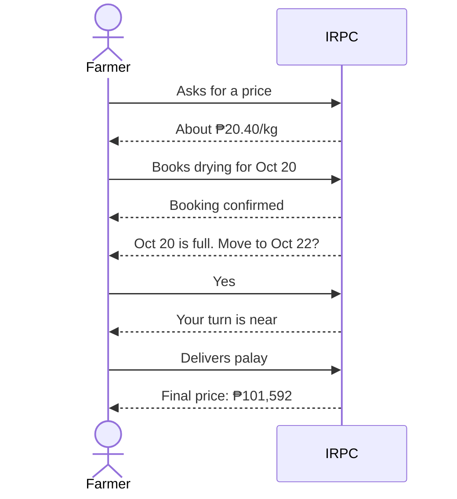
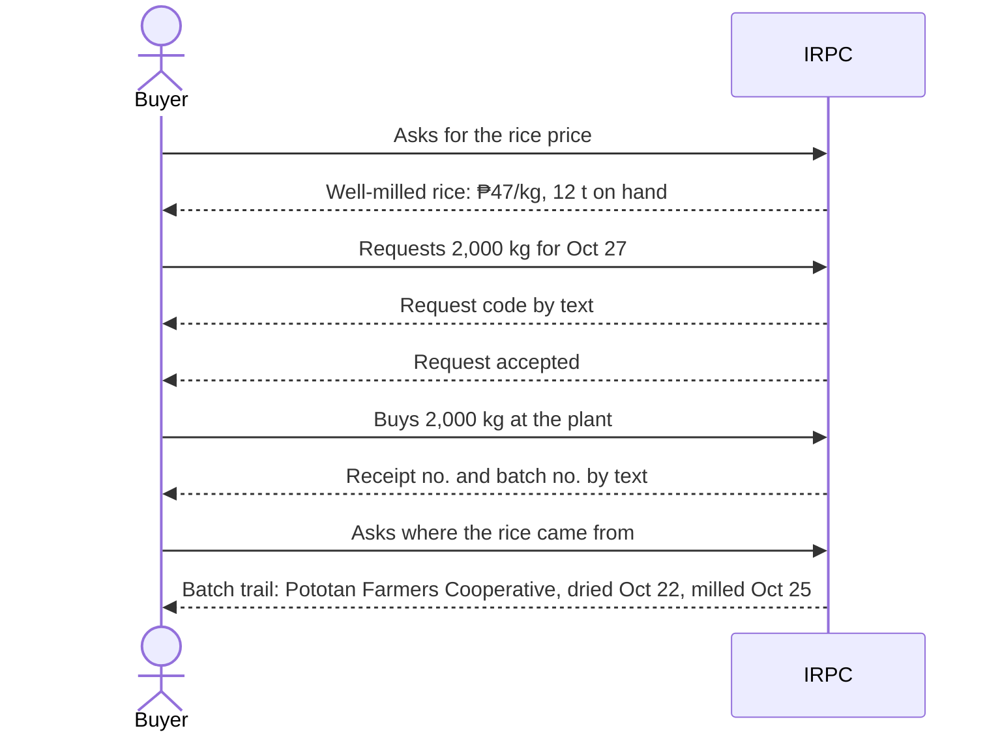
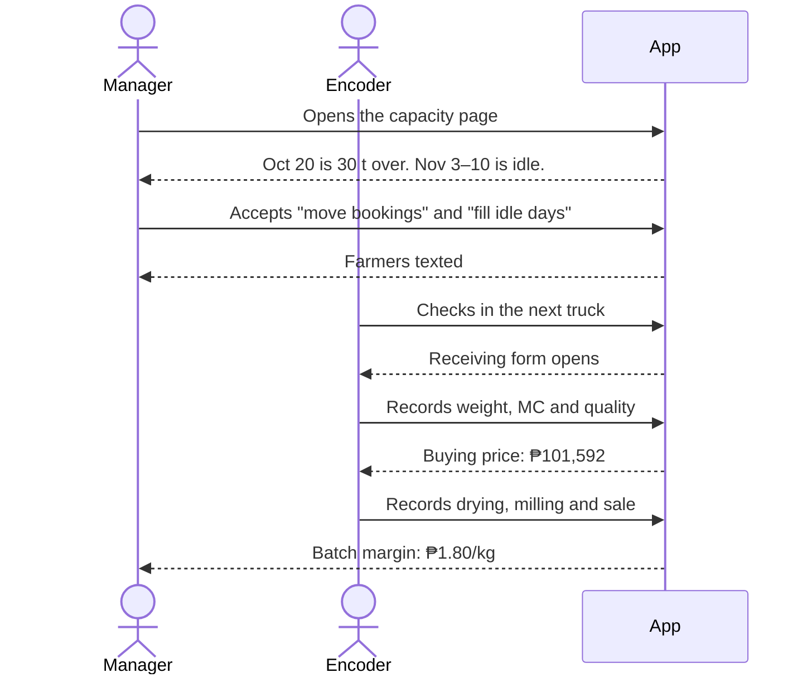
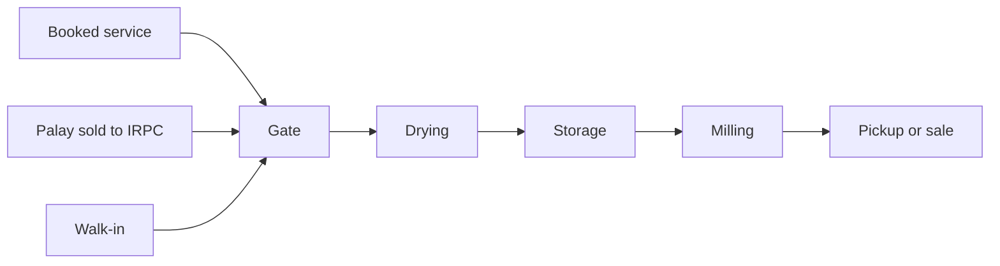
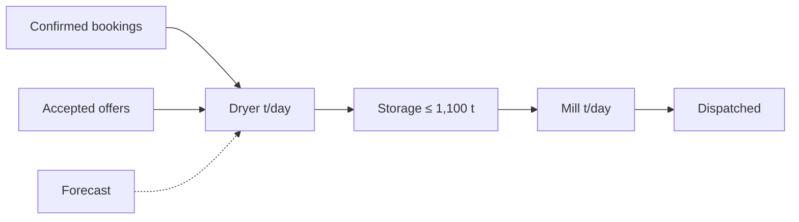

# PRD: Post-Harvest Facility Capacity Planning Platform

## Summary

IRPC can't see palay coming until it reaches the gate. At peak, dryers overflow and farmers go to private mills. Off-season, machines idle while power costs keep running.

This web app with an SMS channel shows IRPC what's coming weeks ahead and suggests what to do:

1. **Clients report what's coming.** By SMS or web, farmers book drying or milling, offer palay for sale and get price quotes; buyers request rice.
2. **The plant sees the next weeks.** Bookings, sell offers and a harvest forecast feed a capacity page for dryers, storage and mill.
3. **The app suggests actions.** Move flexible bookings off busy days, or text farmers before idle stretches.
4. **Staff run the day.** One gate queue, one batch record from receiving to dispatch, priced and costed on the spot.

A farmer's journey (figures illustrative):

A buyer's journey (figures illustrative):

A staff journey (figures illustrative):

## Glossary

| Term          | Meaning                                                                       |
| ------------- | ----------------------------------------------------------------------------- |
| Palay         | Unhusked rice. Wet palay is dried, then stored, then milled.                  |
| MC            | Moisture content (%). Palay arrives at about 23% and is dried to about 14%.   |
| Client        | A farmer, co-op, trader or buyer, identified by phone.                        |
| Booking       | A reserved drying or milling slot on a future day, for the client's palay.    |
| Sell offer    | A client's offer to sell palay to IRPC.                                       |
| Rice request  | A buyer's request to buy milled rice on a pickup date.                        |
| Capacity pool | Dryer (t/day), storage (t held) or mill (t/day).                              |
| Prescription  | An action suggested from capacity numbers. A manager accepts or dismisses it. |
| Batch         | One lot of palay, from the gate to dispatch.                                  |

## Problem

- **Peak (Sep–Oct, Jan–Feb):** palay arrives faster than the dryers can take it. Staff only learn of overloads when trucks arrive.
- **Off-season (Apr–Jul):** dryers and mill sit nearly idle while base power keeps drawing.
- **No batch cost:** cost is known only after the monthly books close.
- **Paper records:** queue, storage level and batch history are in logbooks.
- **Farmers:** can't see prices or open slots, so they call or show up and hope.
- **Buyers:** can't see the rice price or stock, or ask ahead, and the Province can't show where its rice goes.

## Modules

Work is split into issues on the tracker. SMS is a channel, not a dependency: every module works from staff forms first. **P0** must work in the demo. **P1** comes after all P0.

| Module               | Purpose                              | Needs      |
| -------------------- | ------------------------------------ | ---------- |
| M1. Setup            | IRPC settings, machines, seed data   | None       |
| M2. Accounts         | Clients and staff                    | None       |
| M3. SMS              | Sending, receiving and parsing texts | M2         |
| M4. Booking          | Future drying and milling slots      | M1, M2     |
| M5. Selling          | Quotes, sell offers, purchases       | M2, M7     |
| M6. Gate and Batches | Queue, batch record, dispatch        | M2, M4, M5 |
| M7. Pricing and Cost | Prices, batch cost                   | M1, M5, M6 |
| M8. Forecast         | Expected arrivals                    | M1         |
| M9. Capacity         | Load against capacity                | M1, M4–M8  |
| M10. Prescriptions   | Suggested actions                    | M4, M7, M9 |
| M11. Rice Buying     | Rice requests from buyers            | M2, M3, M7 |

How palay moves through IRPC:

How IRPC plans ahead:

### M1. Setup

**P0**

- **Settings:** one IRPC record the manager can edit, since some figures are unconfirmed.
  - **Capacity:** dryers and load size, drying cycle hours, mill t/hour, operating hours, storage (1,100 t).
  - **Costs:** machine kW, base load kW, ₱/kWh, labor ₱/hour.
  - **Planning:** idle threshold, dried kg per wet kg (for storage projections).
- **Varieties:** the rice varieties IRPC handles.
- **Seed:** IRPC's municipalities, sample farmers, co-ops and buyers, and a peak scenario with an overloaded day and an idle stretch.

### M2. Accounts

**P0**

- **Clients:** name, phone, municipality, co-op and kind (farmer, co-op, trader, buyer).
- **Quick registration:** staff register walk-ins in seconds. Unknown phones self-register on their first text.
- **Staff roles:** encoder or manager. Only managers see costs, set prices and act on prescriptions.

### M3. SMS

**P0**

- **Gateway:** a real SMS gateway, plus a phone simulator page for the demo. The simulator is off when the gateway is on.
- **Commands:** keyword texts go to their module by sender phone. Unknown texts get a help reply.
- **Replies:** yes/no questions carry a reference so answers match the right question.

**P1**

- **Plain-language texts:** AI reads free text (converting sacks to kilos), replies with what it understood, and saves nothing until the sender confirms.
- **Queue status:** `STATUS` returns the sender's place in line.

### M4. Booking

The input end for custom service: clients reserve slots for their own palay.

**P0**

- **Book a slot:** from a staff form or by SMS. Drying or milling, with estimated kilos, preferred date and flex days.
- **Book for others:** `FOR <phone>` books for someone else, and the client is texted.
- **Instant confirm:** every booking confirms right away. If the day overloads, M10 proposes a new date to flexible bookings.
- **Ownership:** only the client or whoever booked for them can answer or cancel.
- **Texts:** confirmed (with a reference), and new date proposed (reply to accept).
- **Booking list:** upcoming bookings per service and day.

**P1**

- **Web booking:** book from a phone browser.
- **Web tracking:** check, move, cancel and answer proposals from a phone browser.

### M5. Selling

The input end for IRPC-owned palay. Private mills win on fast, clear quotes, and this is IRPC's answer.

**P0**

- **Quote:** from a staff form or by SMS. Estimated MC (and kilos) gives an estimated price per kilo and total.
- **Sell offer:** from a staff form or by SMS. Kilos, variety and harvest date. Offers feed capacity as expected arrivals.
- **Selling list:** the manager accepts or declines offers.
- **Price at receiving:** computed like the paper Receiving Report from weight, MC, damage, immature grains, foreign matter and sacks. Shown to the encoder and texted to the farmer.
- **Purchase record:** kilos, price, deductions and voucher number. The app doesn't pay.

**P1**

- **Override:** the manager overrides a price with a reason.
- **Budget:** working capital used and remaining.
- **Web sell offer:** quote and offer from a phone browser.

### M6. Gate and Batches

**P0**

- **Check-in:** by booking reference, offer, phone, or as a walk-in. One line per service, first come first served.
- **Live queue:** who's waiting and being served. Starting service texts the next few in line and opens the batch.
- **Batch record:** one record, filled in stages that mirror the paper forms:
  - **Receiving:** bags, net kg, variety, MC, damage, immature grains, foreign matter, ownership (custom or IRPC-bought).
  - **Drying:** dryer, start and end, MC out, dried kg. Skipped for dry palay.
  - **Milling:** start and end, kg in, rice kg, by-products. Recovery is computed.
  - **Dispatch:** buyer, kg, price, receipt number. The buyer is texted the receipt and batch numbers. A batch can have several dispatches.
- **Pickup alerts:** custom clients and their original booker are texted when milling finishes, or when staff mark drying complete and ready for pickup. IRPC-owned batches receive no pickup alert.
- **Weight confirmation:** text the owner at receiving and after drying. YES confirms; NO flags a dispute for re-weighing. Staff can record in-person agreement. Processing continues regardless of confirmation.
- **Trace:** a batch page showing the trail from gate to buyers.
- **Public trace:** `/buy` looks up a sold IRPC batch by batch no. and shows the co-op (else municipality), variety and dates. No personal names.

### M7. Pricing and Cost

**P0**

- **Prices:** the manager sets palay buying base at 25% MC with deduction rates, drying ₱1.60/kg, milling ₱3.30/kg, and rice price.
- **Price texts:** `PRICE` returns today's prices.
- **Batch cost:** electricity (machine hours × kW × ₱/kWh) + labor, against revenue (fees, or sales − purchase). Shown per batch and per kilo.
- **Base load:** reported per period, not per batch. The capacity headline and full-load plan both include it.

### M8. Forecast

**P0**

- **Arrival forecast:** expected arrivals per day for the next ~80 days, from OPA municipal planting reports.
  - **Real data:** trained on OPA 2025, with no synthetic training data.
  - **IRPC's share:** harvest × IRPC's share of each municipality = expected arrivals.
  - **Honest ranges:** shown with error ranges and held-out accuracy.

### M9. Capacity

The manager's main page.

Solid = firm, dashed = estimate. Only firm sources trigger overload.

**P0**

- **Three pools:** dryer, storage and mill.
- **Sources:** each number is labelled by source with a low–high range.
- **Flags:** overloaded days show overflow in tonnes, and idle stretches are marked.
- **Headline:** utilization, overloaded and idle days ahead, and electricity ₱/kg.
- **Chart and grid:** stacked load per day by source with a capacity line, plus a day grid. Clicking a day shows its bookings and suggestions.

**P1**

- **Season:** a monthly heatmap, past from records and future from forecast.
- **Map:** expected harvest per municipality over the next 4–8 weeks.

### M10. Prescriptions

Computed from M9. The manager accepts or dismisses each.

**P0**

- **Plain-language explanation:** each suggestion comes with a short note on why and what it gains, such as "Oct 20 is 30 t over. Moving 3 flexible bookings to Oct 22–23 clears it without turning anyone away." The note is a template filled from the computed numbers, which are shown beside it.
- **Move bookings:** move flexible bookings off a busy day to the nearest days with room. Accepting texts the clients.
- **Fill idle days:** before an idle stretch, text rates and buying prices to farmers and co-ops with no open booking.

**P1**

- **Mill in full loads:** mill stored palay on fewer full days, showing ₱/kg against partial days.
- **Store now, mill later:** at peak, store dried palay and mill it in a quieter week.

### M11. Rice Buying

The output end, mirroring the farmer side: buyers get a form and tracking, as farmers do with booking and selling.

**P0**

- **Web request:** name, phone, buyer type, kilos and pickup date (up to 30 days ahead) from a phone browser. The buyer is texted a code.
- **Tracking:** `/buy/track` with code and phone shows the status. The buyer can cancel while it's requested or accepted.
- **Rice Buying list:** the manager accepts or declines, and the buyer is texted. At pickup, staff record the sale from a batch (kg, price, receipt no.), which texts the receipt and batch no. and links the buyer to the batch.
- **Price at pickup:** the request shows today's rice price as an estimate; the dispatch sets the final price. The app doesn't take payment.
- **Stock:** `/buy` shows IRPC milled rice not yet dispatched.

## Rules

- **SMS is a channel:** every client action (booking, sell offer, quote) also works from a staff form, and SMS commands call the same actions.
- **AI reads, rules decide:** AI reads free-text SMS. Capacity, prescription and cost numbers come from fixed rules, and people confirm every action.
- **No official receipts:** the app only stores receipt and voucher numbers.
- **Cheap to run:** mobile web, SMS for basic phones, no new plant hardware.

## Out of scope

- **Other facilities, crops, regions:** IRPC, rice and Iloilo only. The pitch covers replication.
- **Hiligaynon:** gate receipt, weight-confirmation and pickup texts use concise Hiligaynon/English; other flows retain their existing wording.
- **Money:** paying farmers, issuing receipts, accounting.
- **Integrations:** RSBSA, MAO records, MoRProGRes.
- **Hardware:** meters, sensors or new plant equipment.
- **Apps:** native apps and offline mode.
- **Buyer payment and stock reservation:** requests are confirmed by staff and paid at the plant.
- **Data Privacy Act compliance:** deferred to the pilot.

## Open questions

| Figure            | What we have                                                                    |
| ----------------- | ------------------------------------------------------------------------------- |
| Drying capacity   | 40 t/load (feasibility study: 5 × 8 t) or 56 t (spec sheet: 5 × 10 t + 1 × 6 t) |
| Drying cycle time | Not recorded                                                                    |
| Mill throughput   | 400 bags/day (spec sheet) or 50 t/day (challenge form). Sample run: ~3.1 t/h.   |
| Machine kW        | Unknown                                                                         |
| Electricity price | Unknown                                                                         |

- **Buying price rule:** how MC away from 25% changes the price is unwritten, so it's a setting.
- **Reschedules:** will farmers accept new dates?
- **Forecast trust:** one season of data. Accurate at province level, noisy per municipality and half-month.
- **IRPC's share:** from 2021–2023 purchases. Newer data would settle it.
